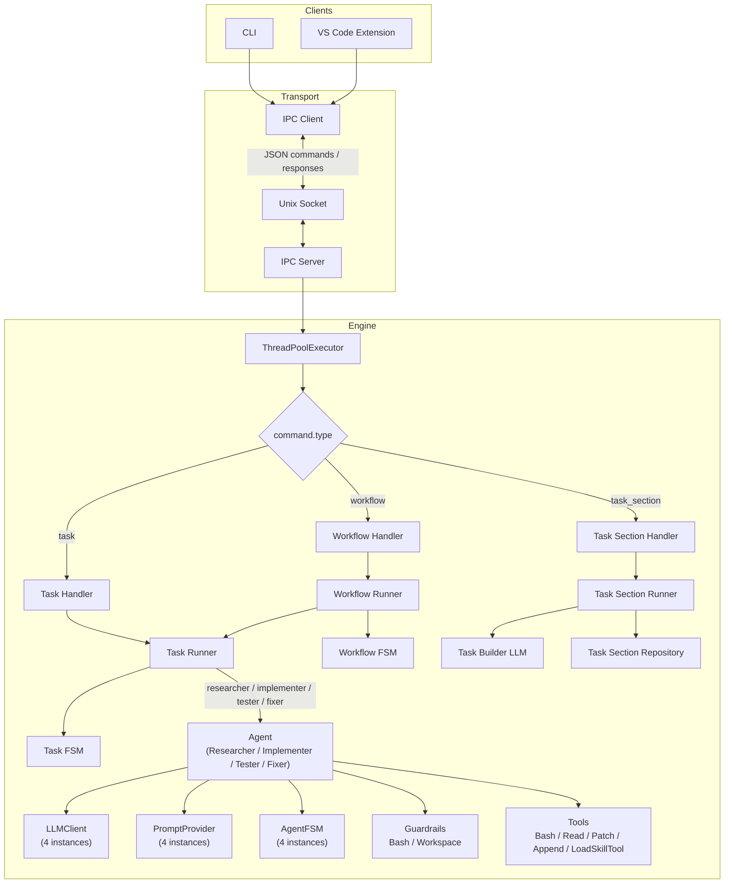

# SDDMA — Мультиагентная система разработки на основе спецификаций

**SDDMA (Specification Driven Development Multi Agent)** — мультиагентная система для автоматизированной разработки программного обеспечения на основе формализованных спецификаций. Система использует специализированных AI-агентов, каждый из которых отвечает за определённый этап разработки: исследование кодовой базы, реализацию изменений, тестирование и исправление ошибок.

## Архитектура

Система состоит из трёх основных компонентов:

- **IPC Server** — серверный компонент, который принимает соединения от клиентов через Unix Socket, получает JSON-команды, передаёт их на обработку в Engine и возвращает результаты выполнения.
- **IPC Client** — клиентский компонент для взаимодействия с IPC Server через Unix Socket. Отправляет JSON-команды и получает ответы сервера.
- **Engine** — исполнительный компонент системы. Обрабатывает поступившие команды, управляет выполнением задач и workflow, координирует работу AI-агентов и формирование спецификаций.

Для взаимодействия с системой предусмотрены два клиентских приложения:

- **CLI** — интерфейс командной строки для запуска задач, workflow и формирования секций спецификаций.
- **VS Code Extension** — расширение редактора Visual Studio Code для взаимодействия с системой непосредственно из IDE.

Оба клиента используют IPC Client для обмена командами с IPC Server. IPC Server и Engine работают на стороне демона.

## CLI

CLI предоставляет интерфейс командной строки для взаимодействия с SDDMA. Через него пользователь может запускать отдельные задачи, workflow и формирование секций спецификаций.

CLI не взаимодействует с Engine напрямую. Для отправки команд и получения результатов он использует IPC Client, который устанавливает соединение с IPC Server через Unix Socket.

## Задача

Спецификация задачи формализует требования, интерфейсы и критерии приёмки, обеспечивая однозначное понимание объёма работ и ожидаемого результата всеми агентами.

Задача состоит из следующих секций:

- **Task** — идентификатор задачи и её основная цель.
- **FullQualifiedNames** — целевые сущности, которые необходимо реализовать, и зависимости, которые необходимо использовать.
- **Interfaces** — контракты целевых сущностей и зависимостей, включая сигнатуры методов и ожидаемое поведение.
- **Sequence** — последовательность взаимодействия компонентов при выполнении задачи, включая успешные сценарии и обработку ошибок.
- **Gherkins** — сценарии приёмочного тестирования, описывающие ожидаемое поведение системы в различных ситуациях.

## Граф задач

Граф зависимостей определяет порядок выполнения задач, позволяет выявлять независимые задачи для параллельной реализации и гарантирует, что необходимые зависимости будут готовы до начала работы над каждой задачей.

Граф задач — ориентированный ациклический граф (DAG), в котором вершины представляют задачи, а направленные рёбра — зависимости между ними. Ребро от задачи A к задаче B означает, что задача B зависит от задачи A и может быть выполнена только после её завершения.

