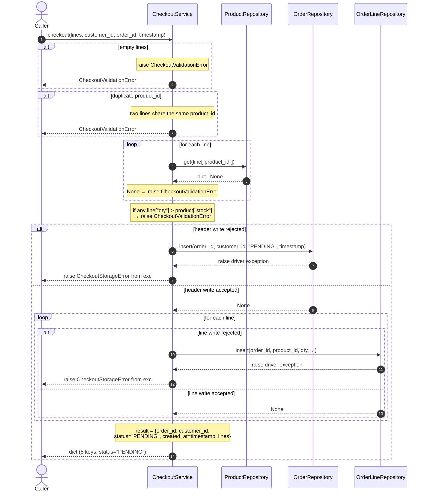

# Task

- task_id: 004_checkout_service

# Goal

Turn a list of order lines into a persisted order; plain-dict API. The service depends on narrow contracts for its three repositories, not on the concrete classes. The caller supplies the order timestamp as a `timestamp: str` argument — the service persists it verbatim and never calls `datetime.now`.

# FullQualifiedNames

| № | FullQualifiedName | Role |
|---:|---|---|
| 1 | `services.checkout::CheckoutError` | target |
| 2 | `services.checkout::CheckoutValidationError` | target |
| 3 | `services.checkout::CheckoutStorageError` | target |
| 4 | `services.checkout::CheckoutService` | target |
| 5 | `services.checkout::ProductRepository` | dependency |
| 6 | `services.checkout::OrderRepository` | dependency |
| 7 | `services.checkout::OrderLineRepository` | dependency |

# Interfaces

## services.checkout::ProductRepository

### Language

python

### Description

The narrow product-repository port the checkout slice reads through.
Narrow structural contract for the product repository.
The port is read-only — it declares only the lookup operation.

### Steps

1. Declare the get operation.

### Returns

A structural repository contract with a get method that returns a product mapping or None.

### Interface

```python
class ProductRepository(Protocol):
    def get(self, product_id: str) -> dict | None:
        ...
```

## services.checkout::OrderRepository

### Language

python

### Description

The narrow order-header-repository port the checkout slice writes through.
Narrow structural contract for the order header repository.
The port is write-only — it declares only the insert operation, no read-back.

### Steps

1. Declare the insert operation.

### Returns

None. The repository inserts one order header and propagates storage rejections unchanged.

### Interface

```python
class OrderRepository(Protocol):
    def insert(
        self,
        order_id: str,
        customer_id: str,
        status: str,
        created_at: str,
    ) -> None:
        ...
```

## services.checkout::OrderLineRepository

### Language

python

### Description

The narrow order-line-repository port the checkout slice writes through.
Narrow structural contract for the order line repository.
The port is write-only — it declares only the insert operation, no read-back.

### Steps

1. Declare the insert operation.

### Returns

None. The repository inserts one order line and propagates storage rejections unchanged.

### Interface

```python
class OrderLineRepository(Protocol):
    def insert(
        self,
        order_id: str,
        product_id: str,
        qty: int,
        unit_amount: str,
        unit_currency: str,
    ) -> None:
        ...
```

## services.checkout::CheckoutError

### Language

python

### Description

Base class for every error raised by the checkout service.
Common superclass for every exception the checkout service raises.
Declared here, in services.checkout. Imported by routers.orders; never redeclared there.

### Steps

1. Inherit from Exception.

### Returns

A CheckoutError exception class.

### Interface

```python
class CheckoutError(Exception):
    pass
```

## services.checkout::CheckoutValidationError

### Language

python

### Description

Raised when a request fails validation before any storage write.
Raised when the lines list is empty, two lines share the same product_id, a line references a missing product, or a line's quantity exceeds its product's stock. The order store is untouched when this is raised. Declared here, in services.checkout. Imported by routers.orders; never redeclared there.

### Steps

1. Inherit from CheckoutError.

### Returns

A CheckoutValidationError exception class.

### Interface

```python
class CheckoutValidationError(CheckoutError):
    pass
```

## services.checkout::CheckoutStorageError

### Language

python

### Description

Raised when the underlying store rejects a write.
Raised when the order repository or the order line repository rejects a write — a primary key conflict, a foreign key violation, or a constraint failure. The original driver exception is preserved on the `__cause__` attribute via raise ... from exc. Declared here, in services.checkout. Imported by routers.orders; never redeclared there.

### Steps

1. Inherit from CheckoutError.

### Returns

A CheckoutStorageError exception class.

### Interface

```python
class CheckoutStorageError(CheckoutError):
    pass
```

## services.checkout::CheckoutService

### Language

python

### Description

Turn a list of order lines into a persisted order; holds no connection.
Service layer for checkout. Validates a list of order lines against product stock, then persists the order header and every line through the order and order-line repositories. The result is assembled from the values written, not read back from storage. Every failure is raised as a typed subclass of CheckoutError — never as a bare ValueError, KeyError, or sqlite3 exception.

The order timestamp is supplied BY THE CALLER as a timestamp: str argument. The service persists it verbatim and never calls datetime.now — time is not a concern of this service.

### Steps

1. Store the three injected repositories on the instance.
2. Expose checkout.
3. Validate the entire lines list before making any storage writes.
4. Reject an empty lines list with CheckoutValidationError before any repository call.
5. Reject duplicate product_id values with CheckoutValidationError before touching the product repository.
6. Look up each product through the product repository and reject missing products with CheckoutValidationError.
7. Reject quantities exceeding product stock with CheckoutValidationError.
8. Persist the order header through the order repository, passing timestamp as created_at. Wrap any storage exception in CheckoutStorageError using raise ... from exc.
9. Persist every line through the order line repository in input order. Wrap any storage exception in CheckoutStorageError using raise ... from exc.
10. Return a mapping assembled from the values written.

### Returns

checkout returns a dict with exactly five keys — order_id, customer_id, status, created_at, lines — where status is "PENDING", created_at is the caller-supplied timestamp, and lines is the input lines list. The constructor returns None.

### Interface

```python
class CheckoutService:
    def __init__(
        self,
        products: ProductRepository,
        orders: OrderRepository,
        lines: OrderLineRepository,
    ) -> None:
        ...

    def checkout(
        self,
        lines: list[dict],
        customer_id: str,
        order_id: str,
        timestamp: str,
    ) -> dict:
        ...
```

# Sequence



# Gherkins

## Scenario: checkout persists order and lines

### FQNs

- CheckoutService

### Gherkin

```gherkin
Given an empty shop store with the schema applied
And a product with id "p1" and stock 10 is persisted
And a checkout service over the repositories
And one line for product "p1" with qty 1, unit_amount "10.00", unit_currency "USD"
When checkout is called for customer "c1", order "o1" and timestamp "2026-01-01T00:00:00+00:00"
Then the returned mapping has exactly five keys
And its status is "PENDING"
And its created_at is "2026-01-01T00:00:00+00:00"
And its lines have one element for product "p1"
And the order header "o1" is persisted with created_at "2026-01-01T00:00:00+00:00"
And the line for product "p1" is persisted under order "o1" with qty 1, unit_amount "10.00", unit_currency "USD"
```

## Scenario: empty lines raises CheckoutValidationError

### FQNs

- CheckoutService
- CheckoutValidationError

### Gherkin

```gherkin
Given an empty shop store with the schema applied
And a checkout service over the repositories
When checkout is called with an empty lines list and timestamp "2026-01-01T00:00:00+00:00"
Then it raises CheckoutValidationError
And the order store is untouched
```

## Scenario: missing product raises CheckoutValidationError

### FQNs

- CheckoutService
- CheckoutValidationError

### Gherkin

```gherkin
Given an empty shop store with the schema applied
And no product with id "p1" is persisted
And a checkout service over the repositories
When checkout is called with one line for product "p1" and timestamp "2026-01-01T00:00:00+00:00"
Then it raises CheckoutValidationError
And the order store is untouched
```

## Scenario: insufficient stock raises CheckoutValidationError

### FQNs

- CheckoutService
- CheckoutValidationError

### Gherkin

```gherkin
Given an empty shop store with the schema applied
And a product with id "p1" and stock 2 is persisted
And a checkout service over the repositories
When checkout is called with one line for product "p1" and qty 5 and timestamp "2026-01-01T00:00:00+00:00"
Then it raises CheckoutValidationError
And the order store is untouched
```

## Scenario: duplicate product raises CheckoutValidationError

### FQNs

- CheckoutService
- CheckoutValidationError

### Gherkin

```gherkin
Given an empty shop store with the schema applied
And a product with id "p1" and stock 10 is persisted
And a checkout service over the repositories
When checkout is called with two lines both for product "p1" and timestamp "2026-01-01T00:00:00+00:00"
Then it raises CheckoutValidationError
And the order store is untouched
And the product repository was never queried
```

## Scenario: header storage rejection raises CheckoutStorageError

### FQNs

- CheckoutService
- CheckoutStorageError

### Gherkin

```gherkin
Given an empty shop store with the schema applied
And a product with id "p1" and stock 10 is persisted
And an order repository that raises a storage exception on insert
And a checkout service over the repositories
And one line for product "p1" with qty 1, unit_amount "10.00", unit_currency "USD"
When checkout is called for customer "c1", order "o1" and timestamp "2026-01-01T00:00:00+00:00"
Then it raises CheckoutStorageError
And the raised exception's __cause__ is the original storage exception
```

## Scenario: line storage rejection raises CheckoutStorageError

### FQNs

- CheckoutService
- CheckoutStorageError

### Gherkin

```gherkin
Given an empty shop store with the schema applied
And a product with id "p1" and stock 10 is persisted
And an order line repository that raises a storage exception on insert
And a checkout service over the repositories
And one line for product "p1" with qty 1, unit_amount "10.00", unit_currency "USD"
When checkout is called for customer "c1", order "o1" and timestamp "2026-01-01T00:00:00+00:00"
Then it raises CheckoutStorageError
And the raised exception's __cause__ is the original storage exception
```

## Scenario: storage error is a subclass of CheckoutError, not validation

### FQNs

- CheckoutService
- CheckoutStorageError
- CheckoutError
- CheckoutValidationError

### Gherkin

```gherkin
Given an empty shop store with the schema applied
And a product with id "p1" and stock 10 is persisted
And an order repository that raises a storage exception on insert
And a checkout service over the repositories
And one line for product "p1" with qty 1, unit_amount "10.00", unit_currency "USD"
When checkout is called for customer "c1", order "o1" and timestamp "2026-01-01T00:00:00+00:00"
Then the raised exception is a CheckoutStorageError
And the raised exception is a CheckoutError
And the raised exception is not a CheckoutValidationError
```