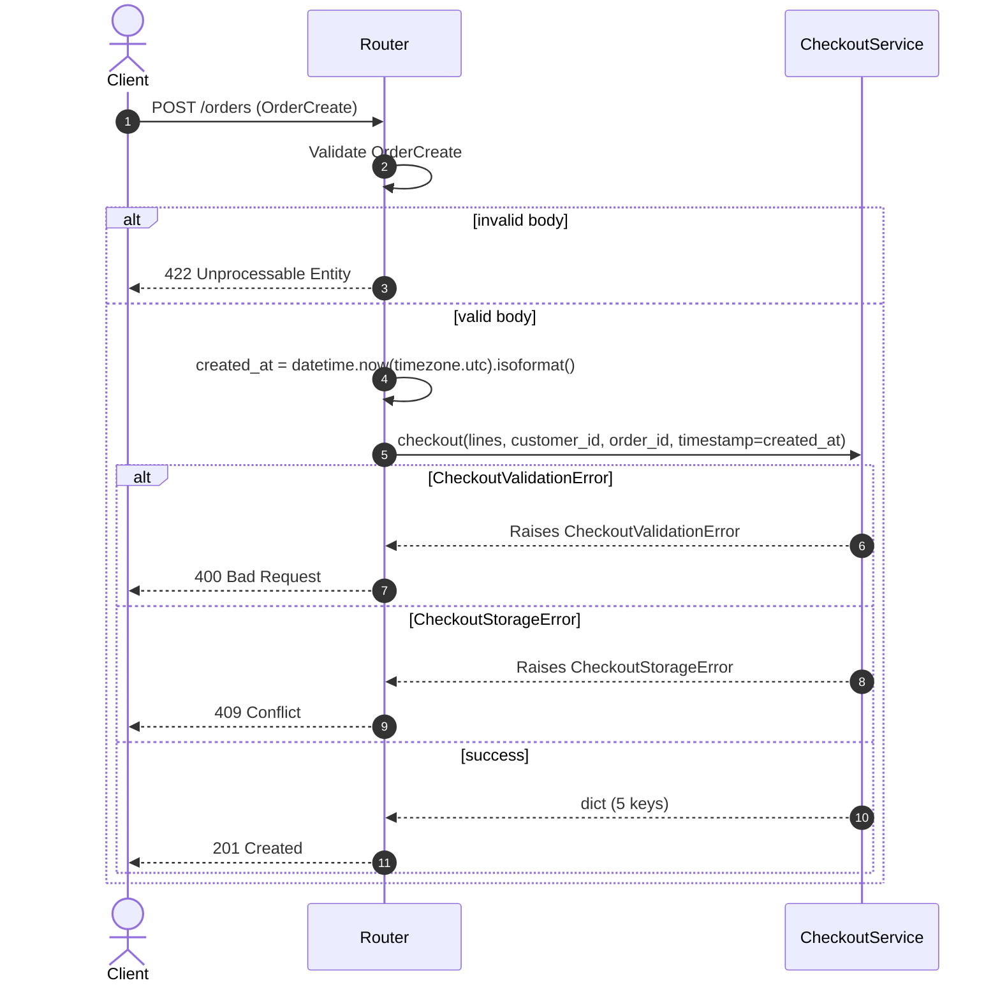

# Task

- task_id: 005_orders_router

# Goal

Build the orders HTTP surface: request and response models, and one create endpoint on POST /orders that delegates to the checkout operation. The endpoint produces the order timestamp via `datetime.now(timezone.utc).isoformat()` and passes it to `checkout`. Map request rejection to 400, storage rejection to 409, success to 201. Every HTTP status code is a named constant from `fastapi.status`.

# FullQualifiedNames

| № | FullQualifiedName | Role |
|---:|---|---|
| 1 | `routers.orders::CheckoutService` | dependency |
| 2 | `routers.orders::CheckoutValidationError` | dependency |
| 3 | `routers.orders::CheckoutStorageError` | dependency |
| 4 | `routers.orders::OrderStatus` | target |
| 5 | `routers.orders::OrderLine` | target |
| 6 | `routers.orders::Order` | target |
| 7 | `routers.orders::OrderCreate` | target |
| 8 | `routers.orders::make_orders_router` | target |

# Interfaces

## routers.orders::CheckoutService

### Language

python

### Description

Narrow structural contract for the checkout service.
The orders router only creates orders — it does not read orders or perform status transitions.
Declares only the checkout operation.
Checkout failures are signalled through CheckoutValidationError and CheckoutStorageError. The router maps HTTP status codes by exception class, never by inspecting exception message text.

### Steps

1. Declare the checkout operation.

### Returns

A structural service contract with a checkout method that accepts order lines, customer_id, order_id, and timestamp, and returns an order mapping.

### Interface

```python
class CheckoutService(Protocol):
    def checkout(
        self,
        lines: list[dict],
        customer_id: str,
        order_id: str,
        timestamp: str,
    ) -> dict:
        ...
```

## routers.orders::OrderStatus

### Language

python

### Description

Closed enumeration of the four allowed order lifecycle statuses.
The wire representation of each value is its uppercase string name.

### Steps

1. Declare PENDING.
2. Declare PAID.
3. Declare SHIPPED.
4. Declare CANCELLED.

### Returns

An OrderStatus string enumeration with exactly four values: PENDING, PAID, SHIPPED, and CANCELLED.

### Interface

```python
class OrderStatus(StrEnum):
    PENDING = "PENDING"
    PAID = "PAID"
    SHIPPED = "SHIPPED"
    CANCELLED = "CANCELLED"
```

## routers.orders::OrderLine

### Language

python

### Description

Request and response model for one order line.
Carries product_id, qty, unit_amount, and unit_currency.
The qty field must be strictly positive.
Instances are immutable after construction and reject unknown fields.

### Steps

1. Declare product_id as a string.
2. Declare qty as an integer constrained to be strictly positive.
3. Declare unit_amount as a string.
4. Declare unit_currency as a string.
5. Reject unknown fields during construction.
6. Freeze instances after construction.

### Returns

An immutable OrderLine model with exactly four fields: product_id, qty, unit_amount, and unit_currency.

### Interface

```python
class OrderLine(BaseModel):
    model_config = ConfigDict(extra="forbid", frozen=True)

    product_id: str = Field(
        ...,
        title="Product ID",
        description="Identifier of the product this line references.",
    )
    qty: int = Field(
        ...,
        gt=0,
        title="Quantity",
        description="Number of units of the product; strictly positive.",
    )
    unit_amount: str = Field(
        ...,
        title="Unit amount",
        description="Price amount per unit, as a decimal string.",
    )
    unit_currency: str = Field(
        ...,
        title="Unit currency",
        description="Currency code of the unit amount, e.g. USD.",
    )
```

## routers.orders::Order

### Language

python

### Description

Immutable, closed response model for one order.
Carries order_id, customer_id, status, created_at, and lines.
The status field is typed as OrderStatus.
The lines field is a list of OrderLine.
Unknown fields are rejected during construction.

### Steps

1. Declare order_id as a string.
2. Declare customer_id as a string.
3. Declare status as OrderStatus.
4. Declare created_at as a string.
5. Declare lines as a list of OrderLine.
6. Reject unknown fields during construction.
7. Freeze instances after construction.

### Returns

An immutable Order model with exactly five fields: order_id, customer_id, status, created_at, and lines.

### Interface

```python
class Order(BaseModel):
    model_config = ConfigDict(extra="forbid", frozen=True)

    order_id: str = Field(
        ...,
        title="Order ID",
        description="Identifier of the persisted order.",
    )
    customer_id: str = Field(
        ...,
        title="Customer ID",
        description="Identifier of the customer who placed the order.",
    )
    status: OrderStatus = Field(
        ...,
        title="Status",
        description="Lifecycle status of the order.",
    )
    created_at: str = Field(
        ...,
        title="Created at",
        description="ISO-8601 timestamp of the moment the order was persisted.",
    )
    lines: list[OrderLine] = Field(
        ...,
        title="Lines",
        description="Order lines persisted with this order, in input order.",
    )
```

## routers.orders::OrderCreate

### Language

python

### Description

Request body model for creating an order.
Carries customer_id, order_id, and lines.
The client does not supply status or created_at; the endpoint determines those values.
The lines field is a list of OrderLine.
Unknown fields are rejected during construction.

### Steps

1. Declare customer_id as a string.
2. Declare order_id as a string.
3. Declare lines as a list of OrderLine.
4. Reject unknown fields during construction.

### Returns

An OrderCreate request model with exactly three fields: customer_id, order_id, and lines.

### Interface

```python
class OrderCreate(BaseModel):
    model_config = ConfigDict(extra="forbid")

    customer_id: str = Field(
        ...,
        title="Customer ID",
        description="Identifier of the customer placing the order.",
    )
    order_id: str = Field(
        ...,
        title="Order ID",
        description="Identifier the caller assigns to the new order.",
    )
    lines: list[OrderLine] = Field(
        ...,
        title="Lines",
        description="Order lines to persist with this order, in the order given.",
    )
```

## routers.orders::make_orders_router

### Language

python

### Description

Builds the orders router closed over the supplied checkout service.
Registers one create endpoint at POST / with prefix /orders and tag orders.
The endpoint produces the order timestamp using datetime.now(timezone.utc).isoformat() and passes it to service.checkout as the timestamp argument.
CheckoutValidationError maps to 400 Bad Request.
CheckoutStorageError maps to 409 Conflict.
Exception dispatch is based on exception class, never on exception message text.
Unexpected exceptions are not caught and propagate to FastAPI's default 500 handler.
Success maps to 201 Created.
Every HTTP status code used by the router is a named constant from fastapi.status.
CheckoutValidationError and CheckoutStorageError are imported from the module that owns the checkout service and are not redeclared in this module.

### Steps

1. Import CheckoutValidationError and CheckoutStorageError from the module that owns the checkout service. Do not declare them in this module.
2. Create an APIRouter with prefix `/orders` and tag `orders`.
3. Register POST `/` with OrderCreate as its request model and Order as its response model.
4. Set the success response status to `status.HTTP_201_CREATED`.
5. In the endpoint, produce created_at using `datetime.now(timezone.utc).isoformat()`.
6. Convert OrderCreate.lines to a list of dictionaries.
7. Call service.checkout with lines, customer_id, order_id, and timestamp=created_at.
8. Catch CheckoutValidationError and raise HTTPException with `status.HTTP_400_BAD_REQUEST` and detail=str(exc), preserving the original exception as the cause.
9. Catch CheckoutStorageError and raise HTTPException with `status.HTTP_409_CONFLICT` and detail=str(exc), preserving the original exception as the cause.
10. Do not catch any other exception.
11. Return the configured router.

### Returns

An APIRouter with one POST `/` endpoint registered under the `/orders` prefix. The endpoint returns an Order response with HTTP 201 on success, maps validation failures to HTTP 400, and maps storage failures to HTTP 409.

### Interface

```python
def make_orders_router(
    service: CheckoutService,
) -> APIRouter:
    ...
```

# Sequence



# Gherkins

## Scenario: create returns 201

### FQNs

- `routers.orders::make_orders_router`
- `routers.orders::test_create_returns_201`

### Gherkin

```gherkin
Given an empty shop store with the schema applied
And a product with id "p1" and stock 10 is persisted
And the current UTC time is pinned to "2026-01-01T00:00:00+00:00"
And a test client over the orders router
When a valid create request is sent for customer "c1" and order "o1" with one line for "p1"
Then the response status is 201
And the body's status is "PENDING"
And the body's created_at is "2026-01-01T00:00:00+00:00"
```

## Scenario: create with empty lines returns 400

### FQNs

- `routers.orders::make_orders_router`
- `services.checkout::CheckoutValidationError`
- `routers.orders::test_create_with_empty_lines_returns_400`

### Gherkin

```gherkin
Given an empty shop store with the schema applied
And a checkout service whose checkout raises CheckoutValidationError with message "lines must not be empty"
And a test client over the orders router
When a create request is sent with an empty lines list
Then the response status is 400
And the response body's detail is "lines must not be empty"
```

## Scenario: create with missing product returns 400

### FQNs

- `routers.orders::make_orders_router`
- `services.checkout::CheckoutValidationError`
- `routers.orders::test_create_with_missing_product_returns_400`

### Gherkin

```gherkin
Given an empty shop store with the schema applied
And a checkout service whose checkout raises CheckoutValidationError with message "product not found"
And a test client over the orders router
When a create request is sent with a line for an unknown product
Then the response status is 400
And the response body's detail is "product not found"
```

## Scenario: create with duplicate order returns 409

### FQNs

- `routers.orders::make_orders_router`
- `services.checkout::CheckoutStorageError`
- `routers.orders::test_create_with_duplicate_order_returns_409`

### Gherkin

```gherkin
Given an empty shop store with the schema applied
And a checkout service whose checkout raises CheckoutStorageError with message "order already exists"
And a test client over the orders router
When a create request is sent for customer "c1" and order "o1"
Then the response status is 409
And the response body's detail is "order already exists"
```

## Scenario: create does not dispatch on message text

### FQNs

- `routers.orders::make_orders_router`
- `services.checkout::CheckoutStorageError`
- `routers.orders::test_create_does_not_dispatch_on_message_text`

### Gherkin

```gherkin
Given an empty shop store with the schema applied
And a checkout service whose checkout raises CheckoutStorageError with message "lines must not be empty"
And a test client over the orders router
When a create request is sent for customer "c1" and order "o1"
Then the response status is 409
And the response status is not 400
```

## Scenario: create with unexpected exception returns 500

### FQNs

- `routers.orders::make_orders_router`
- `routers.orders::test_create_with_unexpected_exception_returns_500`

### Gherkin

```gherkin
Given an empty shop store with the schema applied
And a checkout service whose checkout raises RuntimeError with message "boom"
And a test client over the orders router
When a create request is sent for customer "c1" and order "o1"
Then the response status is 500
```