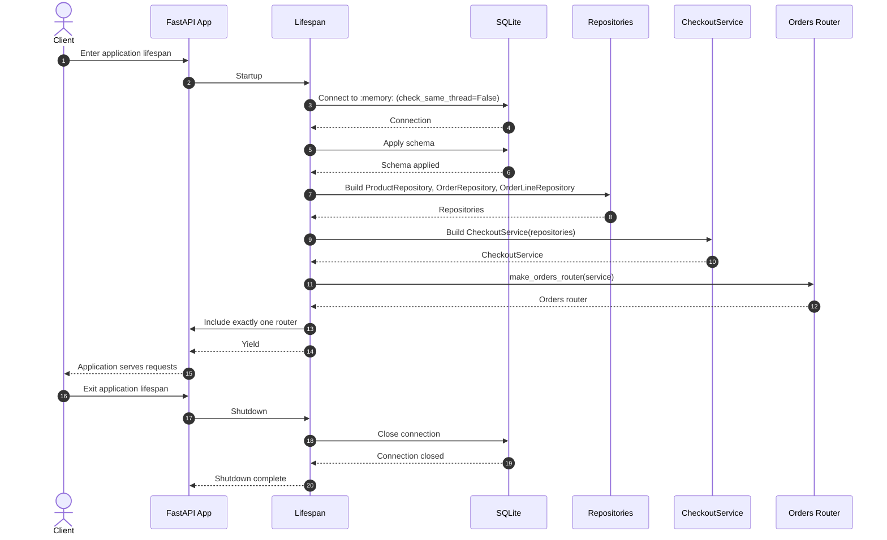

# Task

- task_id: 006_main

# Goal

Wire the whole application at module scope: build the three repositories, the checkout service, and the orders router inside a startup lifecycle; open one in-memory connection on startup and close it on shutdown.

# FullQualifiedNames

| № | FullQualifiedName | Role |
|---:|---|---|
| 1 | `main::lifespan` | target |
| 2 | `main::app` | target |
| 3 | `repositories.products::ProductRepository` | dependency |
| 4 | `repositories.orders::OrderRepository` | dependency |
| 5 | `repositories.order_lines::OrderLineRepository` | dependency |
| 6 | `services.checkout::CheckoutService` | dependency |
| 7 | `routers.orders::make_orders_router` | dependency |
| 8 | `main_test::test_lifespan_app_starts_and_applies_schema` | test |

# Interfaces

## main::lifespan

### Language

python

### Description

Asynchronous context manager that manages the application lifecycle.
Opens one shared in-memory SQLite connection on startup, configured for use from any thread.
Applies the database schema and constructs the three repositories, checkout service, and orders router using that connection.
Attaches exactly one orders router to the application.
Closes the shared connection on shutdown.
The connection is closed even if startup fails after the connection has been opened.
Storage errors from connecting or applying the schema propagate unchanged. Framework errors during startup also propagate unchanged.

### Steps

1. Open one SQLite connection to `:memory:` with `check_same_thread=False`.
2. Enter a finalization scope that guarantees connection closure.
3. Apply the database schema to the connection.
4. Build ProductRepository using the shared connection.
5. Build OrderRepository using the shared connection.
6. Build OrderLineRepository using the shared connection.
7. Build CheckoutService using the three repositories.
8. Create the orders router using make_orders_router and the checkout service.
9. Attach exactly one orders router to the application.
10. Yield control to allow the application to serve requests.
11. Close the shared connection when the lifespan exits, including when startup fails after the connection was opened.
12. Do not catch or transform storage or framework exceptions.

### Returns

An asynchronous context manager yielding None while the application is running. The shared SQLite connection is closed when the context exits.

### Interface

```python
@asynccontextmanager
async def lifespan(app: FastAPI) -> AsyncIterator[None]:
    ...
```

## main::app

### Language

python

### Description

Module-level FastAPI application.
Uses the lifespan context manager to initialize and release application resources.
Has the title "Shop" and version "0.1.0".

### Steps

1. Create one FastAPI application at module scope.
2. Set title to "Shop".
3. Set version to "0.1.0".
4. Set lifespan to the lifespan function.

### Returns

A module-level FastAPI application configured with the application lifespan.

### Interface

```python
app: FastAPI = FastAPI(
    title="Shop",
    version="0.1.0",
    lifespan=lifespan,
)
```

# Sequence



# Gherkins

## Scenario: app starts and applies schema

### FQNs

- `main::lifespan`
- `main::app`
- `main_test::test_lifespan_app_starts_and_applies_schema`

### Gherkin

```gherkin
Given the application module and its lifespan
When the lifespan is entered via a test client context manager
Then the storage catalog contains the tables products, orders, order_lines
And reading an unknown order returns 404
```