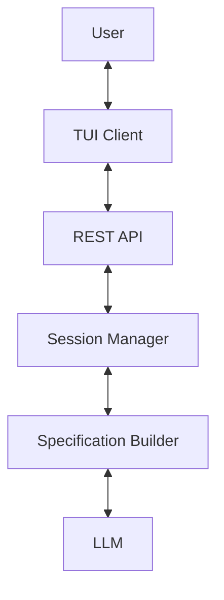

[← Back to README](../README.md)

# REST API Specification Builder Backend

## 1. Общая концепция

REST API Specification Builder Backend предоставляет интерфейс для управления процессом интерактивного создания спецификаций задач разработки с использованием LLM по принципу Human-in-the-Loop.

Backend отвечает за управление сессиями создания спецификаций, последовательное формирование разделов задачи, взаимодействие с LLM, обработку пользовательских сообщений и сохранение согласованного содержимого.

Основной ресурс API — **Specification Session**. Он представляет собой сессию создания одной спецификации задачи.

В рамках одной сессии пользователь последовательно формирует пять разделов:

1. `Task` — идентификатор задачи.
2. `Goal` — цель и требования задачи.
3. `Interfaces` — интерфейсные контракты.
4. `Sequence` — последовательность взаимодействия компонентов.
5. `Gherkins` — сценарии приёмки.

Каждый раздел проходит цикл формирования, обсуждения, редактирования и утверждения пользователем.

## 2. Основные ресурсы

REST API оперирует следующими ресурсами.

### 2.1. Specification Session

`Specification Session` — сессия создания спецификации задачи.

Сессия содержит:

- `session_id` — уникальный идентификатор сессии.
- `status` — текущий статус сессии.
- `current_section` — раздел спецификации, который формируется в данный момент.
- `sections` — содержимое всех разделов спецификации.
- `created_at` — время создания сессии.
- `updated_at` — время последнего изменения сессии.

Возможные статусы сессии:

| Статус | Описание |
|---|---|
| `IN_PROGRESS` | Сессия находится в процессе формирования спецификации. |
| `COMPLETED` | Формирование спецификации завершено. |

### 2.2. Section

`Section` — отдельный раздел спецификации задачи.

Каждый раздел содержит:

- `name` — название раздела.
- `status` — состояние формирования раздела.
- `content` — текущее содержимое раздела.
- `version` — версия содержимого раздела.

Возможные статусы раздела:

| Статус | Описание |
|---|---|
| `PENDING` | Раздел ещё не обрабатывался. |
| `IN_PROGRESS` | Раздел находится в процессе формирования. |
| `APPROVED` | Пользователь утвердил содержимое раздела. |

### 2.3. Message

`Message` — сообщение в диалоге между пользователем и LLM.

Сообщения используются для уточнения требований, обсуждения предложений LLM и корректировки содержимого текущего раздела.

Каждое сообщение содержит:

- `message_id` — уникальный идентификатор сообщения.
- `role` — отправитель (`USER` или `ASSISTANT`).
- `content` — текст сообщения.
- `created_at` — время создания сообщения.

Сообщения сохраняются в рамках сессии и образуют историю взаимодействия пользователя с LLM.

---

## 3. REST API Endpoints

Все endpoints располагаются под общим префиксом `/api/v1`.

### 3.1. Создание сессии

**POST `/sessions`**

Создаёт новую сессию формирования спецификации.

Backend инициализирует пустую спецификацию, устанавливает текущий раздел `Task` и запускает начальное взаимодействие с LLM.

LLM может предложить пользователю сформировать идентификатор задачи или задать уточняющие вопросы.

**Request:**

```json
{}
```

**Response:**

```json
{
  "session_id": "uuid",
  "status": "IN_PROGRESS",
  "current_section": "TASK",
  "sections": {
    "task": {
      "status": "IN_PROGRESS",
      "content": null,
      "version": 1
    }
  },
  "messages": [
    {
      "message_id": "uuid",
      "role": "ASSISTANT",
      "content": "Какой идентификатор задачи вы хотите использовать?",
      "created_at": "2026-11-21T03:00:00Z"
    }
  ],
  "created_at": "2026-11-21T03:00:00Z"
}
```

### 3.2. Получение сессии

**GET `/sessions/{session_id}`**

Возвращает текущее состояние сессии создания спецификации.

Используется TUI Client для восстановления состояния интерфейса при подключении или повторном открытии сессии.

Backend возвращает текущий раздел, его содержимое, статусы остальных разделов и историю диалога.

**Response:**

```json
{
  "session_id": "uuid",
  "status": "IN_PROGRESS",
  "current_section": "GOAL",
  "sections": {
    "task": {
      "status": "APPROVED",
      "content": {
        "task_id": "001_product_repository"
      },
      "version": 1
    },
    "goal": {
      "status": "IN_PROGRESS",
      "content": "Implement product repository",
      "version": 2
    }
  }
}
```

### 3.3. Получение истории сообщений

**GET `/sessions/{session_id}/messages`**

Возвращает историю взаимодействия пользователя с LLM в рамках сессии.

Может использоваться для отображения истории диалога в TUI Client.

**Response:**

```json
{
  "messages": [
    {
      "message_id": "uuid",
      "role": "USER",
      "content": "Нужно реализовать репозиторий продуктов.",
      "created_at": "2026-11-21T03:00:00Z"
    },
    {
      "message_id": "uuid",
      "role": "ASSISTANT",
      "content": "Какие операции должен поддерживать репозиторий?",
      "created_at": "2026-11-21T03:00:05Z"
    }
  ]
}
```

### 3.4. Отправка сообщения

**POST `/sessions/{session_id}/messages`**

Отправляет пользовательское сообщение в текущий диалог с LLM.

Backend сохраняет сообщение пользователя, формирует контекст текущего раздела, отправляет запрос в LLM и сохраняет полученный ответ.

LLM анализирует сообщение и в зависимости от контекста может:

- Задать дополнительные вопросы.
- Предложить содержание раздела.
- Уточнить существующие требования.
- Предложить изменения текущего содержимого.

Если LLM предлагает новое содержимое раздела, Backend обновляет его черновик.

Отправка сообщения сама по себе не означает утверждение раздела.

**Request:**

```json
{
  "content": "Репозиторий должен поддерживать создание, получение и удаление продуктов."
}
```

**Response:**

```json
{
  "message": {
    "message_id": "uuid",
    "role": "ASSISTANT",
    "content": "Предлагаю следующий набор методов: create, get и delete. Нужно ли добавить обновление продукта?",
    "created_at": "2026-11-21T03:00:10Z"
  },
  "section": {
    "name": "GOAL",
    "status": "IN_PROGRESS",
    "content": "Implement a product repository supporting creation, retrieval and deletion of products.",
    "version": 3
  }
}
```

### 3.5. Получение раздела

**GET `/sessions/{session_id}/sections/{section_name}`**

Возвращает содержимое конкретного раздела спецификации и его текущий статус.

Используется для отображения содержимого раздела в TUI Client.

Возможные значения `section_name`:

- `task`
- `goal`
- `interfaces`
- `sequence`
- `gherkins`

**Response:**

```json
{
  "name": "GOAL",
  "status": "IN_PROGRESS",
  "content": "Implement a product repository.",
  "version": 3
}
```

### 3.6. Редактирование раздела

**PUT `/sessions/{session_id}/sections/{section_name}`**

Позволяет пользователю самостоятельно отредактировать содержимое текущего раздела.

Backend сохраняет переданное содержимое и обновляет его версию.

Редактирование не утверждает раздел автоматически. После изменения пользователь может продолжить обсуждение с LLM или утвердить результат.

**Request:**

```json
{
  "content": "Implement a product repository supporting CRUD operations."
}
```

**Response:**

```json
{
  "name": "GOAL",
  "status": "IN_PROGRESS",
  "content": "Implement a product repository supporting CRUD operations.",
  "version": 4
}
```

### 3.7. Утверждение раздела

**POST `/sessions/{session_id}/sections/{section_name}/approve`**

Подтверждает окончательное содержимое текущего раздела.

Backend проверяет наличие содержимого и его соответствие требованиям полноты раздела.

После успешного утверждения:

1. Раздел получает статус `APPROVED`.
2. Backend определяет следующий раздел спецификации.
3. Текущий раздел обновляется.
4. Запускается формирование следующего раздела с помощью LLM.
5. TUI Client получает предложение или вопрос для нового раздела.

Последовательность формирования:

`TASK → GOAL → INTERFACES → SEQUENCE → GHERKINS`.

**Request:**

```json
{}
```

**Response:**

```json
{
  "approved_section": "GOAL",
  "current_section": "INTERFACES",
  "status": "IN_PROGRESS",
  "message": {
    "role": "ASSISTANT",
    "content": "Теперь определим интерфейсы, необходимые для реализации задачи."
  }
}
```

### 3.8. Повторное открытие раздела

**POST `/sessions/{session_id}/sections/{section_name}/reopen`**

Позволяет пользователю вернуться к ранее утверждённому разделу и изменить его содержимое.

Backend снимает утверждение с выбранного раздела и возвращает его в состояние `IN_PROGRESS`.

При этом необходимо учитывать зависимости между разделами.

Например, изменение `Goal` может потребовать повторного согласования `Interfaces`, `Sequence` и `Gherkins`.

Backend должен снять утверждение с последующих зависимых разделов, чтобы итоговая спецификация оставалась согласованной.

**Response:**

```json
{
  "section": "GOAL",
  "status": "IN_PROGRESS",
  "current_section": "GOAL"
}
```

### 3.9. Получение итоговой спецификации

**GET `/sessions/{session_id}/specification`**

Возвращает полное содержимое спецификации задачи в структурированном формате.

Доступен после завершения формирования всех обязательных разделов.

**Response:**

```json
{
  "task": {
    "task_id": "001_product_repository"
  },
  "goal": "Implement a product repository.",
  "interfaces": [],
  "sequence": null,
  "gherkins": []
}
```

### 3.10. Экспорт спецификации

**GET `/sessions/{session_id}/export`**

Формирует итоговый Markdown-файл спецификации задачи, совместимый с Specification-Driven Development Multi-Agent Engine.

Backend объединяет утверждённое содержимое всех разделов в единый документ, соблюдая установленную структуру Markdown.

Ответ возвращается в виде файла `text/markdown`.

Имя файла может формироваться на основе `task_id`, например:

`001_product_repository.md`.

### 3.11. Завершение сессии

**POST `/sessions/{session_id}/complete`**

Завершает сессию создания спецификации.

Backend проверяет, что все обязательные разделы утверждены, а спецификация прошла проверку полноты и согласованности.

После успешного завершения сессия получает статус `COMPLETED`.

Повторное редактирование завершённой спецификации через эту сессию не допускается.

---

## 4. Жизненный цикл сессии

Сессия проходит последовательные этапы формирования спецификации.

1. **Создание сессии**

   `IN_PROGRESS`

   Инициализация спецификации и начало работы с разделом Task.

2. **Формирование Task**

   LLM совместно с пользователем определяет идентификатор задачи. После утверждения происходит переход к Goal.

3. **Формирование Goal**

   Уточнение цели, функциональных требований и ограничений.

4. **Формирование Interfaces**

   Определение компонентов, их контрактов и инструкций по реализации.

5. **Формирование Sequence**

   Определение последовательности взаимодействия компонентов.

6. **Формирование Gherkins**

   Создание сценариев приёмки и ожидаемого поведения компонентов.

7. **Завершение сессии**

   `COMPLETED`

   Проверка спецификации и формирование итогового Markdown-документа.

## 5. Обработка ошибок

REST API возвращает стандартные HTTP-коды в зависимости от результата выполнения операции.

| HTTP | Описание |
|---|---|
| `200 OK` | Операция успешно выполнена. |
| `201 Created` | Сессия успешно создана. |
| `400 Bad Request` | Некорректные входные данные. |
| `404 Not Found` | Сессия или раздел не найдены. |
| `409 Conflict` | Операция противоречит текущему состоянию сессии. |
| `422 Unprocessable Entity` | Содержимое не прошло проверку. |
| `500 Internal Server Error` | Внутренняя ошибка Backend. |
| `502 Bad Gateway` | Ошибка взаимодействия с LLM-провайдером. |

Пример ответа с ошибкой:

```json
{
  "error": {
    "code": "SECTION_NOT_APPROVED",
    "message": "The previous section must be approved first."
  }
}
```

## 6. Ответственность компонентов

Взаимодействие TUI Client, Backend и LLM организовано следующим образом:



**TUI Client** отвечает за отображение состояния сессии, истории диалога, предложений LLM и содержимого спецификации. Он передаёт пользовательские сообщения, изменения содержимого и команды утверждения разделов через REST API.

**REST API** предоставляет HTTP-интерфейс для взаимодействия с Backend. Принимает запросы от TUI Client, проверяет входные данные и передаёт операции соответствующим компонентам Backend.

**Session Manager** управляет сессиями создания спецификаций. Отвечает за создание, получение, обновление и сохранение состояния сессий.

**Specification Builder** управляет процессом формирования спецификации. Определяет текущий раздел, формирует контекст для LLM, обрабатывает ответы модели, пользовательские уточнения и утверждения разделов.

**LLM** используется для анализа требований, генерации предложений, уточнения информации и формирования содержимого разделов спецификации.

---

## 7. Итоговая структура REST API

| Метод | Endpoint | Назначение |
|---|---|---|
| POST | `/sessions` | Создание сессии |
| GET | `/sessions/{id}` | Получение состояния сессии |
| GET | `/sessions/{id}/messages` | Получение истории диалога |
| POST | `/sessions/{id}/messages` | Отправка сообщения LLM |
| GET | `/sessions/{id}/sections/{name}` | Получение раздела |
| PUT | `/sessions/{id}/sections/{name}` | Редактирование раздела |
| POST | `/sessions/{id}/sections/{name}/approve` | Утверждение раздела |
| POST | `/sessions/{id}/sections/{name}/reopen` | Повторное открытие раздела |
| GET | `/sessions/{id}/specification` | Получение полной спецификации |
| GET | `/sessions/{id}/export` | Экспорт Markdown-файла |
| POST | `/sessions/{id}/complete` | Завершение сессии |

---

[← Back to README](../README.md)
