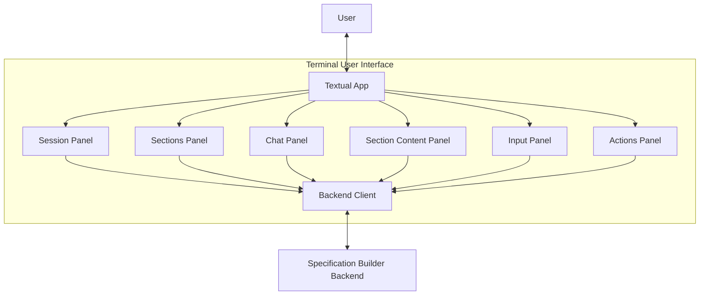

[← Back to README](../README.md)

# Terminal User Interface

Terminal User Interface (TUI) — терминальный клиент для интерактивного взаимодействия пользователя со Specification Builder Backend. Реализуется на Python с использованием библиотеки [Textual](https://textual.textualize.io/).

TUI предоставляет графический интерфейс в терминале, позволяющий пользователю совместно с LLM формировать, редактировать и утверждать разделы спецификации.

Клиент взаимодействует с Backend исключительно через REST API и не содержит логики формирования спецификации или непосредственного взаимодействия с LLM.

## 1. Основные компоненты интерфейса

Интерфейс состоит из следующих областей:

1. **Session Panel** — отображает информацию о текущей сессии:
   - `session_id` — идентификатор сессии.
   - `status` — текущий статус сессии.
   - `current_section` — раздел, находящийся в процессе формирования.

2. **Sections Panel** — отображает список разделов спецификации и их статусы:
   - `TASK`
   - `GOAL`
   - `INTERFACES`
   - `SEQUENCE`
   - `GHERKINS`

   Для каждого раздела отображается его текущее состояние: `PENDING`, `IN_PROGRESS` или `APPROVED`.

3. **Chat Panel** — отображает историю взаимодействия пользователя с LLM. Сообщения пользователя и ассистента визуально различаются. Поддерживает прокрутку истории диалога.

4. **Section Content Panel** — отображает текущее содержимое выбранного раздела спецификации. Позволяет просматривать и редактировать содержимое раздела.

5. **Input Panel** — предоставляет поле ввода пользовательских сообщений и отправки их в Backend. Используется для ответов на вопросы LLM, уточнения требований и обсуждения предложенного содержимого.

6. **Actions Panel** — предоставляет команды управления процессом формирования спецификации:
   - `Approve` — утверждение текущего раздела.
   - `Reopen` — повторное открытие ранее утверждённого раздела.
   - `Complete` — завершение сессии.
   - `Export` — экспорт итоговой спецификации в Markdown.

## 2. Основные компоненты приложения

Реализация TUI строится на следующих компонентах Textual:

- **App** — корневой компонент приложения. Управляет жизненным циклом интерфейса, инициализацией сессии и взаимодействием между компонентами.
- **Screen** — экран приложения, объединяющий панели сессии, разделов, диалога, содержимого спецификации и действий пользователя.
- **Container / Horizontal / Vertical** — компоненты компоновки интерфейса.
- **Static** — отображение статической информации, включая идентификатор сессии и статусы разделов.
- **RichLog** — отображение истории сообщений с поддержкой форматирования и прокрутки.
- **TextArea** — ввод и редактирование содержимого разделов спецификации и пользовательских сообщений.
- **Input** — однострочный ввод пользовательских сообщений.
- **Button** — выполнение команд утверждения, повторного открытия и завершения сессии.
- **Footer** — отображение доступных клавиатурных сочетаний.
- **ModalScreen** — диалоговые окна подтверждения потенциально значимых действий, например завершения сессии.

## 3. Backend Client

`Backend Client` — компонент, инкапсулирующий взаимодействие TUI с REST API Specification Builder Backend.

Отвечает за выполнение HTTP-запросов и преобразование полученных ответов в данные, используемые компонентами интерфейса.

Реализует операции:

- `create_session()` — создание новой сессии.
- `get_session(session_id)` — получение состояния сессии.
- `get_messages(session_id)` — получение истории диалога.
- `send_message(session_id, content)` — отправка сообщения пользователя.
- `get_section(session_id, section_name)` — получение содержимого раздела.
- `update_section(session_id, section_name, content)` — редактирование содержимого раздела.
- `approve_section(session_id, section_name)` — утверждение раздела.
- `reopen_section(session_id, section_name)` — повторное открытие раздела.
- `get_specification(session_id)` — получение полной спецификации.
- `export_specification(session_id)` — экспорт спецификации в Markdown.
- `complete_session(session_id)` — завершение сессии.

Для HTTP-взаимодействия используется асинхронный клиент `httpx.AsyncClient`.

## 4. Основные сценарии взаимодействия

**Создание сессии**

1. Пользователь запускает TUI-приложение.
2. Приложение предлагает создать новую сессию или продолжить существующую.
3. При создании новой сессии TUI вызывает `POST /sessions`.
4. Полученное состояние сессии отображается в интерфейсе.
5. Начальное сообщение LLM отображается в Chat Panel.

**Формирование раздела**

1. Пользователь читает сообщение LLM в Chat Panel.
2. Отправляет ответ через Input Panel.
3. TUI вызывает `POST /sessions/{id}/messages`.
4. Полученный ответ LLM отображается в Chat Panel.
5. Если Backend обновил содержимое раздела, TUI обновляет Section Content Panel.
6. Пользователь может продолжить обсуждение или самостоятельно отредактировать содержимое раздела.

**Утверждение раздела**

1. Пользователь проверяет содержимое текущего раздела.
2. Нажимает `Approve`.
3. TUI вызывает `POST /sessions/{id}/sections/{name}/approve`.
4. Полученное состояние отображается в интерфейсе.
5. Следующий раздел становится текущим, а начальное сообщение LLM отображается в Chat Panel.

**Редактирование раздела**

1. Пользователь изменяет содержимое в Section Content Panel.
2. Нажимает `Save`.
3. TUI вызывает `PUT /sessions/{id}/sections/{name}`.
4. После успешного сохранения отображает обновлённое содержимое и его версию.

**Экспорт спецификации**

1. Пользователь нажимает `Export`.
2. TUI вызывает `GET /sessions/{id}/export`.
3. Полученный Markdown сохраняется в локальный файл.
4. Путь к сохранённому файлу отображается пользователю.

## 5. Архитектура взаимодействия

## 6. Технические требования

- Язык реализации — Python 3.10+.
- Библиотека TUI — `textual`.
- HTTP-клиент — `httpx`.
- Формат обмена данными с Backend — JSON.
- Взаимодействие с Backend осуществляется исключительно через REST API.
- HTTP-запросы выполняются асинхронно.
- Длительные HTTP-операции не должны блокировать обработку пользовательского ввода.
- Ошибки REST API отображаются непосредственно в интерфейсе.
- При повторном открытии сессии TUI восстанавливает её состояние, содержимое разделов и историю сообщений.
- Адрес Backend задаётся через конфигурацию приложения.

Таким образом, Terminal User Interface обеспечивает удобное терминальное взаимодействие с Specification Builder, предоставляя пользователю полный контроль над формированием, редактированием и утверждением спецификации на каждом этапе Human-in-the-Loop процесса.

---

[← Back to README](../README.md)
